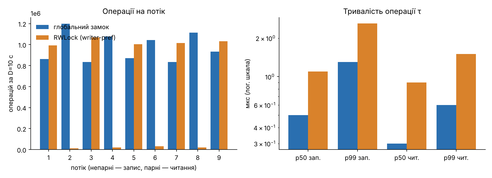

# Лабораторна робота 5. Потокобезпечна структура даних (варіант 3)

Структура **C3 — LRU-кеш**, P = 500, ключі 0..4999, n = 9 потоків
(запис: потоки 1,3,5,7,9 → n_w = 5; читання: 2,4,6,8 → n_r = 4).
Мова: Python (CPython). Заборонених готових потокобезпечних колекцій не використано:
лише `threading.Lock`, `threading.Condition`.

## Файли
- `lru_bench.py` — структура, замки, стенд, перевірка інваріантів.
- `run_all.py` — повна серія вимірювань (≈ 7 хв), результати у `results/*.json`.
- `analyze.py` — таблиці 1–7 (`results/tables.md`) і рисунок `results/lab5_overview.png`.

## Запуск
```
python run_all.py          # повна серія, D = 10 с, прогрів 1 с, 3 запуски кожного режиму
python analyze.py results  # таблиці
```
Перед запуском закрийте інші програми (вимір на одній машині без стороннього навантаження).

## Реалізація
- **LRU**: `dict` (хеш-таблиця ключ → вузол) + двозв'язний список використання з сторожовими вузлами.
  `put` і `get` переставляють вузол на початок (тому в ролі «запис», 50:50),
  `peek` лише читає `dict` і значення вузла — жодне поле не змінюється (перевіряє `--mode selftest`).
- **Попереднє заповнення**: половина простору ключів (2500 ключів) більша за ємність 500,
  тому кеш перед кожним запуском заповнюється до ємності P випадковими ключами з 0..2499.
- **Аргументи** (ключ, вибір put/get) генеруються блоками до виклику, до `t_call`.
- **Глобальний замок** — один `threading.Lock` навколо кожної операції.
- **RWLock** на `threading.Condition` у трьох політиках (`--policy`):
  `writer` (основна: читачі чекають, поки є активний або очікуючий писар),
  `reader` (читачі входять, поки немає *активного* писаря), `fair` (FIFO за квитками).
- Метрики за означеннями завдання (D = 10 с після прогріву 1 с, τ = t_ret − t_call, t_wait = t_acq − t_call,
  p_q = τ_(⌈qN⌉), cv — популяційне σ/μ), t_cs і X_1 — окремі режими `tcs` і `x1`.
- Інваріанти після кожного запуску: |кеш| ≤ P, ключі списку = ключі таблиці, prev/next узгоджені, без дублікатів.

## Умови вимірювань
Windows, CPython 3.14.5, 6 логічних ядер, одна машина без стороннього навантаження.
n = 9 потоків завжди. D = 10 с після прогріву 1 с, 3 запуски, у таблицях — медіана.
Основна політика RWLock — **writer-preference** (читач чекає, поки є активний *або очікуючий* писар;
писар чекає лише активних читачів/писаря). Інваріанти (|кеш| ≤ P, ключі списку = ключі таблиці,
узгодженість prev/next) виконані після всіх 21 запусків; `peek` не змінює жодного поля (selftest).

## Результати
### Таблиця 1. Параметри стенду

| n | n_w | n_r | Мова і версія | Логічні ядра | X_1 (G), оп/с | X_1 (RW), оп/с | Інваріанти (крок 2) | Інваріанти (крок 3) |
| --- | --- | --- | --- | --- | --- | --- | --- | --- |
| 9 | 5 | 4 | CPython 3.14.5 | 6 | 876 511 | 544 281 | виконано | виконано |

Перевірка «читання не змінює полів»: peek не змінив жодного поля = True; контроль (get переставляє запис) = True.

### Таблиця 2. Глобальний замок (медіана з 3 запусків)

| Роль | Операцій за D | X, оп/с | p50, мкс | p99, мкс | max t_wait, мс | w | cv | t_cs, мкс |
| --- | --- | --- | --- | --- | --- | --- | --- | --- |
| запис | 4 308 916 | 430 892 | 0.50 | 1.30 | 326.66 | 0.698 | 0.076 | 0.389 |
| читання | 4 412 916 | 441 292 | 0.30 | 0.60 | 326.35 | 0.702 | 0.119 | 0.161 |
| разом | 8 786 154 | 878 615 | 0.30 | 1.20 | 383.88 | 0.707 | 0.183 | 0.288 |

Одно потокові виміри: t_cs,w = 0.389 мкс, t_cs,r = 0.161 мкс, t̄_cs = 0.288 мкс, межа 1/t̄_cs = 3 476 999 оп/с.

### Таблиця 3. RWLock (медіана з 3 запусків)

| Роль | Операцій за D | X, оп/с | p50, мкс | p99, мкс | max t_wait, мс | w | cv |
| --- | --- | --- | --- | --- | --- | --- | --- |
| запис | 5 132 379 | 513 238 | 1.10 | 2.60 | 620.26 | 0.697 | 0.063 |
| читання | 70 865 | 7 086 | 0.90 | 1.50 | 11 249.83 | 0.793 | 0.578 |
| разом | 5 229 555 | 522 956 | 1.10 | 2.60 | 11 249.83 | 0.734 | 0.875 |

### Таблиця 4. Операцій на потік за D

| Потік | Роль | Глобальний замок | RWLock |
| --- | --- | --- | --- |
| 1 | запис | 862 995 | 992 964 |
| 2 | читання | 1 197 551 | 12 643 |
| 3 | запис | 834 162 | 1 069 590 |
| 4 | читання | 1 078 087 | 20 816 |
| 5 | запис | 869 782 | 1 004 009 |
| 6 | читання | 1 042 117 | 30 167 |
| 7 | запис | 835 147 | 1 016 165 |
| 8 | читання | 1 114 110 | 19 882 |
| 9 | запис | 932 777 | 1 032 191 |

### Таблиця 5. Масштабування і насичення

| Замок | X(n), оп/с | X_1, оп/с | S(n) | E(n) |
| --- | --- | --- | --- | --- |
| глобальний | 878 615 | 876 511 | 1.002 | 0.111 |
| RWLock | 522 956 | 544 281 | 0.961 | 0.107 |

| S_w | S_r | S_Σ | ρ = X(G)·t̄_cs | X(G) | 1/t̄_cs |
| --- | --- | --- | --- | --- | --- |
| 1.191 | 0.016 | 0.595 | 0.253 | 878 615 | 3 476 999 |

### Таблиця 6. Порівняння доступу до даних

| Показник | G: запис | G: читання | RW: запис | RW: читання | RW/G запис | RW/G читання |
| --- | --- | --- | --- | --- | --- | --- |
| X, оп/с | 430 892 | 441 292 | 513 238 | 7 086 | 1.191 | 0.016 |
| x на потік, оп/с | 86 178 | 110 323 | 102 648 | 1 772 | 1.191 | 0.016 |
| p50, мкс | 0.50 | 0.30 | 1.10 | 0.90 | 2.200 | 3.000 |
| p99, мкс | 1.30 | 0.60 | 2.60 | 1.50 | 2.000 | 2.500 |
| h = p99/p50 | 2.60 | 2.00 | 2.36 | 1.78 | 0.909 | 0.889 |
| max t_wait, мс | 326.66 | 326.35 | 620.26 | 11 249.83 | 1.899 | 34.472 |
| w | 0.698 | 0.702 | 0.697 | 0.793 | 0.997 | 1.129 |
| cv | 0.076 | 0.119 | 0.063 | 0.578 | 0.829 | 4.855 |
| φ | 0.494 | 0.506 | 0.986 | 0.014 | 1.997 | 0.027 |

### Таблиця 7 (додатково). Політики RWLock

| Політика | X, оп/с | X_w | X_r | p99 запис, мкс | p99 читання, мкс | max t_wait запис, мс | max t_wait читання, мс | cv запис | cv читання | Інваріанти |
| --- | --- | --- | --- | --- | --- | --- | --- | --- | --- | --- |
| writer (основна) | 522 956 | 513 238 | 7 086 | 2.60 | 1.50 | 620.26 | 11 249.83 | 0.063 | 0.578 | ok |
| reader | 623 503 | 160 802 | 463 600 | 2.50 | 1.50 | 2 332.75 | 578.26 | 0.241 | 0.065 | ok |
| fair (FIFO) | 20 940 | 11 633 | 9 307 | 616.40 | 615.40 | 30.49 | 33.73 | 0.000 | 0.000 | ok |



## Аналіз

**Масштабування (крок 4).** S(9) = 1.00 і E(9) = 0.11 ≈ 1/9 для глобального замка: дев'ять потоків дають
стільки ж операцій, скільки один (X = 879 тис. оп/с проти X_1 = 877 тис.). Це наслідок GIL CPython:
потоки з Python-кодом виконуються по черзі, тому паралелізму читань немає за жодного замка.
Для RWLock S(9) = 0.96. Межа 1/t̄_cs = 3.48 млн оп/с, а X(G) = 0.88 млн, тобто ρ = 0.25 < 1:
пропускну здатність обмежує не критична секція (t̄_cs = 0.29 мкс із ≈1.14 мкс на цикл операції),
а інтерпретатор разом з GIL, генерація аргументів та вимір часу поза замком.
Глобальний замок не насичений.

**Перехід G → RWLock (крок 5).** S_Σ = 0.60: загальна швидкість впала, S_w = 1.19, S_r = 0.016.
- **Писарі виграли доступ**: X_w 431 → 513 тис. оп/с (×1.19), x на потік 86 → 103 тис. оп/с. Причина:
  при пріоритеті писарів читачі майже виключені, і весь час GIL/замка діставався писарям (φ_w 0.49 → 0.99).
  Частка очікування w_w не змінилась (0.698 → 0.697), cv_w трохи зменшився (0.076 → 0.063).
  Це виграш за пропускною здатністю, а не за часткою очікування. Хвіст τ у писарів при цьому гірший:
  p99 1.3 → 2.6 мкс, p50 0.5 → 1.1 мкс, бо захоплення/відпускання RWLock на `Condition` у Python
  значно дорожче за `Lock` (X_1: 877 → 544 тис. оп/с).
- **Читачі втратили доступ**: X_r 441 → 7 тис. оп/с (×0.016). Це пов'язано насамперед з **нерівномірністю
  між потоками** (cv_r 0.12 → 0.58, окремі читачі за запуск отримували 0 операцій, див. таблицю 4) і зі
  зростанням **частки очікування** (w_r 0.70 → 0.79); найбільше очікування читача 0.33 с → 11.2 с,
  що більше за D = 10 с, тобто читач простоював усе вікно (очікування почалося ще під час прогріву, тому
  воно перевищує D). Це голодування читачів. Хвіст τ самих виконаних операцій читання навіть не погіршився
  суттєво в абсолюті (p99 0.6 → 1.5 мкс): вся втрата в очікуванні замка.
- Найбільше очікування писаря зросло 0.33 → 0.62 с, але лишилось менше за D: писарі не голодують.

**Інші політики (таблиця 7, додатково).** Reader-preference міняє ролі місцями: читачі отримують 464 тис. оп/с
(≈ як під глобальним замком, 441 тис.), а писарі падають до 161 тис. (×0.37) з очікуванням до 2.3 с,
cv_w = 0.24. Загальний X = 624 тис., вище за writer-preference, бо читання дешевше. Fair (FIFO за квитками)
дає ідеальну рівність (cv = 0) і відсутність голодування (макс. очікування ≈ 30 мс), але X лише ≈ 21 тис. оп/с:
кожна передача замка будить усі потоки (`notify_all`), і в CPython це ≈ 40-кратна втрата швидкості.
Жодна політика не перевищила X(G) суттєво: виграш від паралельних читань неможливий під GIL.

**Висновок.** У цій реалізації (CPython, GIL) RWLock не дає переваги над одним мьютексом: читання не
виконуються паралельно, а замок на `Condition` дорожчий. Перерозподіл доступу між ролями визначається
політикою RWLock: writer-preference віддає доступ писарям і голодить читачів (видно у cv та t_wait),
reader-preference робить навпаки, FIFO вирівнює все ціною пропускної здатності. Реальний виграш RWLock для
переважно читальних навантажень можна очікувати лише в мовах без GIL (Go, Rust) або в free-threaded Python.

## Відхилення та обмеження
- Попереднє заповнення: див. вище (кеш заповнюється до ємності P ключами з 0..2499).
- `get` віднесено до запису (змінює порядок), `peek` — до читання.
- t_cs вимірюється двома викликами `perf_counter_ns` навколо операції (накладні ≈ десятки нс входять у t_cs).
- Максимальне очікування враховує операції, що перетинають межі вікна D, без обрізання; через це воно
  може бути більшим за D.
- `w` для операцій, що перетинають кінець вікна, враховується лише в межах вікна.
- Одна машина, Windows, 6 логічних ядер < n = 9 потоків; через GIL це майже не впливає на результат.
